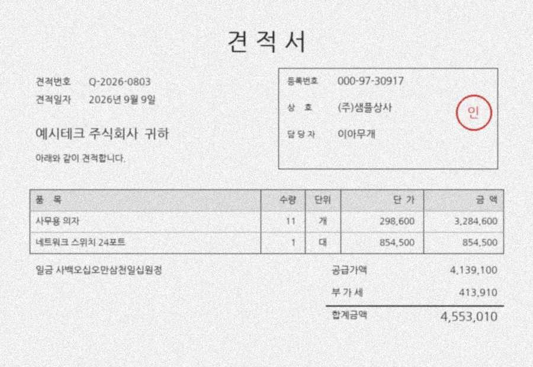
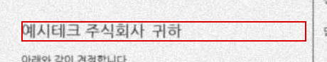
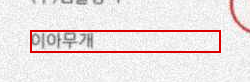

# img-vlm-extractor

[한국어](README.md) | **English**

This is not an engine that extracts values from images — it is an engine that **decides whether an extracted value can be trusted**.
It uses code to catch the places where a VLM writes a plausible wrong answer, and hands the untrustworthy ones to a human **together with where and why they are suspicious**.

The goal is a single **specimen** — when values must be extracted from **synthetic quotation (견적서)** images,
the experiments show **what to assign to code, OCR, and the VLM so that errors are blocked while the VLM is used to its fullest**.

> Experiments live in the notebook ([`notebooks/02_role_split.ipynb`](notebooks/02_role_split.ipynb)); only confirmed rules were
> moved into code ([`backend/app`](backend/app)). The rules were frozen before looking at test-set scores (tag `rules-frozen`).

---

## What problem it solves

OCR turns an image into characters; a VLM **answers questions.** So even on documents with varied layouts or a bit of mess,
it can point to "where the total is" and read it. In exchange, a new kind of failure appears.

```
"35,000" is printed faintly on a receipt

OCR  →  "3S,OOO"      comes out broken → the oddity is visible
VLM  →  "38,000"      confidently writes a plausible number → nothing looks wrong
```

**The danger of a VLM is not that it fails to read, but that it plausibly makes things up.**
Broken output can be filtered out; a plausible wrong answer passes straight through.

---

## Splitting the roles

|  | Good at | How it fails | Assigned job |
|---|---|---|---|
| **VLM** | Messy images · understanding layouts · "which one is the total" | **Fabricates** plausibly | Reading, semantic judgment |
| **OCR** | Clean text · **coordinates per character** | Breaks (visibly) | Evidence check, location |
| **Code** | Arithmetic · format · cross-checking | Doesn't err (if the rules are right) | Verification, final decision |

```
Document image
  ├─ VLM      reads the values
  └─ OCR      reads characters and coordinates     ★ OCR does not fabricate
       ↓
  Code checks  arithmetic · format (checksum) · "does the VLM's value exist in the image's text?"
       ↓
  Decision     auto-process  /  to a human → review.csv (document · field · reason · location)
```

**The default is to hand it to a human.** Auto-processing only accepts fields with a passing signal (check passed or OCR evidence).
No evidence, a human looks at it.

**The model only reads; code does the calculation and the decision.** If you leave arithmetic to the model, it not only gets it wrong
but **you can no longer tell where it went wrong.**

### Example checks

| Document | Check | What it catches |
|---|---|---|
| Receipt | Σ item prices ≈ subtotal · subtotal + tax ≈ total | Misread numbers · missing items |
| Quotation | unit price × quantity = supply amount · supply amount × 10% = VAT | Misread numbers |
| Common | Business registration number check digit · date format | Plausible-looking numbers · nonexistent dates |
| Common | Is the VLM's value among the OCR tokens? | **A number not in the image = a fabricated value** |

★ **Passing a check is not evidence; it is a failure to disprove.** In measurements, 12% of values that passed the check were wrong
(see "Experiment log" below). So instead of relying on one check, mechanisms of different nature are layered.

★ **Values read by the same VLM agreeing with each other is not evidence.** The VLM calculates even when not asked —
if it misreads a unit price, it computes the amount from that price and writes it, so `unit price × quantity = amount` holds. Therefore a check
counts as evidence only when it descends from an **independently confirmed anchor** (the large-print total + the Korean-written amount, or OCR).

---

## Results — on unseen synthetic quotations

30 synthetic quotations × 3 degradation levels (light blur · blur+compression · low resolution). Scored **once** after the rules were frozen.

| Level | Fields | **Missed errors** | Flagged (sent to human) | On dev set |
|---|---|---|---|---|
| Light blur L0.5 | 696 | **0** (0.0%) | 14.7% (102/696) | 0 · 10.1% |
| Blur+compression L1 | 696 | **0** (0.0%) | 33.3% (232/696) | 0 · 30.7% |
| Low resolution L2 | 696 | **0** (0.0%) | 79.2% (551/696) | 0 · 81.7% |

- **Not a single wrong value was auto-processed** — 100% recall for error detection. The price is precision: correct values are also
  handed over when suspicious, so the worse the image, the more fields a human must review. The design targets incidents (missed errors) and treats review volume as the cost
- Reading accuracy on the same images — for numbers at low resolution, **VLM 75.1% vs OCR 0.6%**; for text at light blur the two are similar
  (OCR 88.1% · VLM 87.2%). The VLM reads more; code and OCR decide whether those values can be trusted
- The frozen code's decisions **match the notebook field-by-field** — 2,148 dev fields · 2,088 test fields

### Compared with an OCR pipeline — auto-processing rate

Same test documents, **same decision rules**; only the reading side was switched to OCR. OCR uses the text inside each field's template position as that field's value
(no ground-truth positions used). The design was fixed before seeing results.

| Level | | Accuracy | **Auto rate** | Missed errors |
|---|---|---|---|---|
| Light blur L0.5 | OCR | 71.4% | 67.7% (471/696) | 2.7% (19) |
| | **VLM** | 96.0% | **85.3%** (594/696) | **0** |
| Blur+compression L1 | OCR | 14.1% | 11.9% (83/696) | 2.2% (15) |
| | **VLM** | 90.2% | **66.7%** (464/696) | **0** |
| Low resolution L2 | OCR | 0.1% | 0.9% (6/696) | 0.9% (6) |
| | **VLM** | 59.6% | **20.8%** (145/696) | **0** |

- **The VLM side auto-processes more, with zero missed errors.** Applying the same rules to OCR yields less auto-processing and leaked errors
- Why OCR leaks — the evidence signal is "did OCR's two reading modes read the same value", but when OCR is the reader, that is the same illusion
  made twice and cannot serve as evidence (`Q-2026` → `0-2026`, `80g` → `809` read identically by both modes). **The reader and the checker must
  differ for a check to be a check** — this is the basis for the split where the VLM reads and OCR verifies
- The OCR extraction is a baseline using template positions only. Only two extraction bugs found on the dev set (reading the Korean-written amount line below the table as an item ·
  the honorific '귀하' after the company name) were fixed according to the template structure; nothing else was tuned. The dev set shows the same shape
  (auto rate OCR 72 · 13 · 1% vs VLM 90 · 69 · 18%)

### Single-page demo — unseen scan quality, with the real CLI

One quotation not in the dev or test sets (seed 2026) was generated with a **never-before-used degradation** (gray paper · blur · scanner noise · JPEG)
and run through `img-vlm`. 3 real VLM calls (2,189 · 864 · 855 tokens).



| | Auto-processed (all correct) | Review — caught a wrong value | Review — correct but flagged | Missed errors |
|---|---|---|---|---|
| **VLM pipeline** | **12 / 18 fields** | 2 (VLM-fabricated `에시테크` · `이아무게`) | 4 | **0** |
| OCR pipeline | 3 / 18 fields | 14 (couldn't read items/total on the gray background) | 1 | 0 |

The VLM **plausibly rewrote** the company name and the contact person's name (예시테크 → 에시테크, 이아무개 → 이아무게 — one-character look-alike substitutions), and with no OCR evidence, both
went to a human. Looking only at the crop images in `review.csv` is enough to fix them immediately.

 

Being a single page, this is an **operational check**, not a score.

### Verify it yourself — no API key needed

```bash
cd backend && pip install -e ".[dev]"
pytest                      # decision reproduction · scores · CLI · retry rules (32 tests)
python tests/evaluate.py    # the numbers in the tables above
```

The evaluation data (`backend/tests/fixtures/eval_{dev,test}.json.gz`, 0.2 MB each) contains, per document, **OCR tokens · VLM responses · ground truth ·
notebook decisions**. They are fed straight into the frozen pipeline to check that decisions and scores match.
What is *not* reproduced is also stated — since images are not included, **OCR itself and the pixel content of crops** are not re-run
(crop positions and sizes are verified). The scoring function uses the same amount/date parsing as the decision code.

---

## How it is proven

### Research questions

| | Question |
|---|---|
| RQ1 | As images get messier, who reads better, OCR or VLM — is there a crossover? |
| RQ2 | How does the VLM fail — `null` / garbled / **plausible wrong answer**? |
| RQ3 | How many plausible wrong answers do code mechanisms (checks · checksums · OCR cross-check) catch? |
| RQ4 | **How should the VLM be called** so that it fabricates less? (V0–V3 below) |
| RQ5 | Combined — how much human review can be cut while keeping missed errors at 0? |

### Comparing ways of using the VLM (RQ4)

| | Method | Conclusion |
|---|---|---|
| V0 | Baseline — give only the schema and have it extract values | **Adopted** |
| V1 | "If not visible, `null`; copy characters as seen; no calculation" | No effect — instructions are requests |
| V2 | Supply the OCR token list and have it **pick tokens by number** | Not used — it can fix almost no numbers, and OCR stops being independent evidence |
| V3 | Crop the total/date regions, re-read them, and compare both answers | **Adopted** — a total match is an anchor; a date mismatch is a refutation |

### Creating errors instead of waiting for them

On clean images, VLM errors are rare (0 total errors across 41 CORD images). Waiting would never finish the experiment, so:

- **Degradation** — apply blur · JPEG compression · low resolution · stains in stages
- **Masking** — erase specific fields. The correct answer for that field is "unreadable", so **writing any number is itself fabrication**

### Metrics

| | Meaning | Target |
|---|---|---|
| **Missed error** | Auto-processed but wrong — an incident (FN) | **0** = 100% error-detection recall |
| False alarm | Correct but flagged as suspicious (FP) | Minimize — precision |
| Flag rate | Share sent to humans | Minimize — review cost |

The same documents pass through every method to **compare methods against each other** (OCR alone · VLM alone · combined).
Since samples are small, ratios are always written with counts — `12.0% (12/100)`.

**Documents used to choose rules are separate from documents used to score.** Decision rules are chosen on the dev set, and the final numbers
come from applying them **once** to a held-out test set. Choosing and reporting on the same documents produces rules fitted to those documents.

---

## What is not used

| | Reason |
|---|---|
| Vector DB · embeddings | Pulling fixed values from a single page is **extraction, not retrieval** |
| Arithmetic by an LLM | Code is exact and verifiable |
| Final decision · scoring by an LLM | If the decision is a model too, you can't know what to trust. Ground truth exists, so scoring is done in code too |
| Agents | The steps are fixed — a workflow pinned at 3 VLM calls per document |
| Fine-tuning | What prompts couldn't fix was solved with code and guards. Training is the option for when that fails |
| Cross-checking with another VLM | Two models from the same family shared the same illusions (0/41 disagreements). The cross-check signal must be of a different nature |

If a requirement that needs search appears, the right move is to add a separate retrieval layer at that point.
RAG is covered in a separate repository ([md-rag-chatbot](https://github.com/songwookun/md-rag-chatbot)).

---

## Remaining design for safe use

| | How |
|---|---|
| Instructions inside documents (prompt injection) | Text in the image is treated as untrusted data. The VLM has no tools or permissions, its output is only the values read, and auto-processing happens only after passing code checks and OCR evidence |
| External API failures | Waits on per-minute limits; retries 5xx · timeouts · malformed responses with backoff; stops and saves immediately on daily limits; exits at once on key errors. Documents whose request is refused go to a human |
| Logging | Per document, model · per-call prompt hash · tokens · elapsed time · processing time are recorded in the result JSON |
| Secrets | Keys live only in `.env`. Organization IDs in error messages are masked |
| Personal data | Every document in this repository is fake. For real documents, mask before sending to an external API, or serve the same weights in-house (Qwen has open weights) |
| Model swaps | The model name is a setting. Changing it invalidates the scores, so the dev/test evaluations are re-run |

---

## Limitations and open problems

### Made hard on purpose — scenario tests (dev set, 0 API calls)

The "0 missed errors" in the scores concerns **errors the VLM actually produced**. Errors that could happen but haven't yet were injected on purpose.

| Scenario | Current rules — missed errors | With position check added |
|---|---|---|
| Supplier ↔ recipient swapped | **45 · 16 · 0** | 0 · 0 · 0 |
| Item names shifted by one row (name paired with the next row's amount) | **79 · 19 · 0** | 0 · 0 · 0 |
| Normal documents — auto rate | 90 · 69 · 18% | 90 · 69 · 18% (unchanged) |

The current rules look for OCR evidence **without position**. So any text that exists somewhere on the document counts as evidence even if written into another field.
Narrowing evidence to **within that field's template position** blocks both scenarios and loses almost nothing on normal documents.
It was measured only on the dev set, so it is not yet in the frozen rules — adding it requires re-scoring on a new test set.

### The name-fabrication problem — what was tried

| Method | Result |
|---|---|
| Instruction — "as seen; null if unsure" (V1) | No effect |
| Pick from OCR tokens (V2) | OCR stops being independent evidence → not used |
| Client list — trust if in the list | On a list with many similar names, missed errors **5 · 43 · 20** → rejected. A name the VLM confused passes if it happens to be a real name |
| Client list — trust if OCR matches within one character | Missed errors **5 · 21 · 0** → rejected. Allowing a one-character difference can't separate exactly that one-character illusion (개/게) |
| Client list — spelling correction only, decision unchanged | 0 missed errors on every list. Name-field auto rate 78 · 18 · 0% → 83 · 40 · 0% (with a list of few similar names) |

### Open problem

**Name fields at low resolution are 0% auto-processed under every method.** The VLM fills unreadable characters with plausible ones
(예시테크 → 에시테크), and at the same resolution OCR reads nothing, so there is no independent signal to confirm. Neither instructions nor lists stopped it.

→ The remaining problem is **getting the VLM to reveal on its own that "I couldn't read this character"** (per-character confidence · abstention).
With that signal, review volume could be cut at low resolution, where humans have the most fields to check.

The next step is to **add the position check above to the decision rules and re-score on a new test set** — its effect is confirmed on the dev set, and since it changes the rules, the scores must be produced anew.

---

## Experiment log

Only what was confirmed by measurement is listed.

| | Result | Date |
|---|---|---|
| Image input + schema-enforced output | Works | 2026-09-06 |
| VLM | `qwen/qwen3.8-27b` (Groq) — open-source weights | 2026-09-06 |
| Total-check rules | **131/131 hold** on ground-truth labels (5 branches) | 2026-09-07 |
| VLM baseline (41 CORD images) | Total **100%** · item names **61%** — breaks down on name–amount pairing | 2026-09-07 |
| Limits of checks | **3/25 wrong** among check-passed values — checks alone are not enough | 2026-09-07 |
| Cross-check of two same-family models | Total disagreements **0/41** — same-family models can't cross-validate | 2026-09-07 |
| Local OCR | `tesseract 5.5.2` (`kor` · `eng`) | 2026-10-03 |
| OCR baseline (10 synthetic quotations) | Number reading: original **93%** → blur+compression **70%** → low resolution **1%** | 2026-10-03 |
| OCR config dependence | On blurry images, one reading mode gives **18% vs 67%** — can't choose without knowing the image condition | 2026-10-03 |
| **OCR vs VLM** (same 34 images) | Number reading — light blur OCR 91% / **VLM 100%** · low resolution OCR **1%** / **VLM 74%** | 2026-10-04 |
| How the VLM fails | **Computes amounts itself** from a misread unit price, passing the check · gets the date and document number wrong **with the same illusion** | 2026-10-04 |
| Guards (34 dev images) | Anchor chain · processing-date plausibility · OCR mode disagreement → missed errors **18 → 0**. But low-resolution flag rate 96% · **not validated on test** | 2026-10-04 |
| Unseen documents (90 dev items) | The 3 guards missed **2 fabricated date months** not seen in the 34 images — the limit of rules built by looking | 2026-10-05 |
| V3 crop re-read (90 doc-levels) | When the total crop **matches the full read, 20/20 correct** → the anchor at low resolution. Date crops share the same illusion, so used only for refutation — mismatches caught month fabrication, low-resolution missed errors **0** · flagged **78%** | 2026-10-09 |
| V1 instructions (20 low-res) | "As seen · no calculation · null if unsure" — **no effect**. Calculation traces rose from 7 → 10 lines and null was barely used. Prompt fixed at V0 | 2026-10-09 |
| Offsetting errors | V1 got two item amounts wrong by **+20k · −20k** so the sum matched → if any line is wrong, a Σ match does not vouch for items. Cost: low-res flag rate 78 → 82% | 2026-10-09 |
| V2 upper bound (90 doc-levels, 0 API) | Fields where the answer is in OCR and V0 was wrong = the most V2 could fix — numbers **0 · 0 · 2 /492**, text at most 37/224 at L1. Meanwhile, if the VLM copies OCR, OCR evidence stops being independent → **V2 not used** | 2026-10-10 |
| Pipeline (`backend/app/engine`) | Confirmed notebook rules ported as-is — **all 2,148 field decisions on 90 dev doc-levels match the notebook** (`tests/test_eval.py`, 0 API). 3 VLM calls per document | 2026-10-10 |
| **Test-set scores** (90 doc-levels) | Once, after rules frozen — missed errors **0 · 0 · 0**, flagged **15 · 33 · 79%**. Frozen code vs notebook on 696 low-res fields: **0** differences | 2026-10-13 |
| Scenario tests · position check | Swaps · item-name shifts: current rules miss 45 · 16 / 79 · 19 → 0 with position check, normal auto rate unchanged (dev set) | 2026-10-13 |
| Client-list correction | List-as-signal (B) · OCR approximate match (C) broke on similar-name lists and were rejected; spelling correction only (A) is safe (dev set) | 2026-10-13 |
| Single-page demo (real CLI) | Unseen scan quality — VLM auto 12/18 fields all correct, 2 VLM-fabricated names sent to review · OCR auto 3/18 fields | 2026-10-13 |
| OCR pipeline comparison | Same decision rules, OCR as reader — test auto rate OCR **68 · 12 · 1%** vs VLM **85 · 67 · 21%**, OCR missed errors 19 · 15 · 6 fields | 2026-10-13 |
| 2 code reviews | Found and fixed issues such as result files getting mixed in the CLI/client and one document blocking the whole run; confirmed via mutation that tests catch it if the fixes break again. Decision logic unchanged | 2026-10-13 |
| Cost | **$0** — only free tiers and local tools | 2026-09-07 |

### Not done yet

| | Reason |
|---|---|
| Real documents · other templates | Results are for **one synthetic quotation template**. Crop and review positions use that template's (900×1273) coordinates |
| Test-set V3 on light blur · blur+compression | VLM number reading is already 100% at those levels — the daily call limit was spent on low resolution only. On the dev set, scores at those two levels were the same with or without V3 |
| Masking | "Does it fabricate when it can't read" was already observed naturally at low resolution |
| Truncated responses | If the output length limit breaks the JSON, the whole document currently goes to review (safe). Treating it as a retryable transport error is a post-freeze task |

### Free-tier limits shaped the experiment design

| | Measured limit | Effective throughput |
|---|---|---|
| Groq `qwen3.8-27b` | **200,000** tokens per day (stated only in the 429 response body) | **About 60–70 calls per day** — the limit counts ≈2,100–2,700 per call almost regardless of image size (cropping doesn't raise throughput) |
| Gemini `2.5-flash` | **20 requests** per day | Insufficient for experiment scale |

The original design was to **cross-check two VLMs from different vendors**. Gemini's free limit couldn't run at that
scale, so the second signal was switched to **OCR**. OCR runs locally without limits and,
above all, **does not fabricate** — a more independent signal than another VLM.
Experiments were split so that one conclusion comes out per day within the daily limit.

---

## Running

```bash
brew install tesseract tesseract-lang   # local OCR (including Korean)

cd backend
python -m venv .venv && source .venv/bin/activate
pip install -e ".[dev]"
cp .env.example .env      # fill in GROQ_API_KEY — https://console.groq.com/keys (free)

img-vlm quotations_dir -o out              # saves and stops on hitting the daily limit; re-run the same command to resume
img-vlm quotations_dir -o out --max-calls 30
```

| Output | Contents |
|---|---|
| `out/results/<name>.json` | Field values · decision (auto/review) · reason · location · call log |
| `out/review.csv` | **Only fields for human review** — document · field · value · reason · location · path to a crop image with a red box (opens directly in Excel) |

Exit codes: `0` all processed · `75` documents remaining (retry later) · `1` key/config error.
To run the experiment notebooks: `pip install -e ".[dev,lab]"`.

---

## Data

### Real — CORD

**CORD** is used as the real-receipt control group. It has ground-truth labels and **per-character coordinates**,
its **license is stated at the source**, and it has line items so total checks can be measured.

> **CORD: A Consolidated Receipt Dataset for Post-OCR Parsing**
> Seunghyun Park, Seung Shin, Bado Lee, Junyeop Lee, Jaeheung Surh, Minjoon Seo, Hwalsuk Lee
> (NAVER CLOVA) · Document Intelligence Workshop at NeurIPS, 2019
> Source <https://github.com/clovaai/cord> · Distribution <https://huggingface.co/datasets/naver-clova-ix/cord-v2>
> License **[CC BY 4.0](https://creativecommons.org/licenses/by/4.0/)**
>
> *Changes:* This repository **does not include** the original images or labels. They are downloaded at run time,
> only the fields needed for evaluation are extracted, and values are normalized for comparison (amount → number, date → ISO).
> Degradation and masking experiments use transformed versions of the downloaded images.

### Synthetic — quotations

Business documents are **generated here.** Values are fixed first and then the document image is drawn,
so **the correct value and position of every field are known from the start.** No real companies, people, or business numbers are used;
images are not committed to the repository and are regenerated by code (only the one demo page is kept in `docs/experiments/demo/`).

★ Ground truth is used **only for scoring.** The decision code is separated so it cannot see the ground truth — if decisions could see it,
experimental results would be perfect and useless in practice.

Drawing conclusions from synthetic documents alone could mean *"a method that only works on documents I made"*, so CORD is used alongside.

**Experiments used a single quotation template.** Conclusions apply to this synthetic quotation.

### Decided not to use

| | Reason |
|---|---|
| FUNSD | Non-commercial academic use only. This repository is public, so there is room for conflict |
| SROIE | **No license stated.** See below |

SROIE was originally adopted as "the safest option because it's MIT", but **on cross-checking, that was wrong.**
That MIT is the license of [a competition team's code repository](https://github.com/zzzDavid/ICDAR-2019-SROIE)
(which doesn't even contain the data); the official RRC page, the competition paper, and the HuggingFace mirror
nowhere state a license for the dataset itself. It is not forbidden but **unknown**,
and anything that can't be justified was not used.

## License

MIT — applies to **the code in this repository**. See `LICENSE`.
Public datasets used in experiments follow the terms in the "Data" section above and are not included in this repository.
